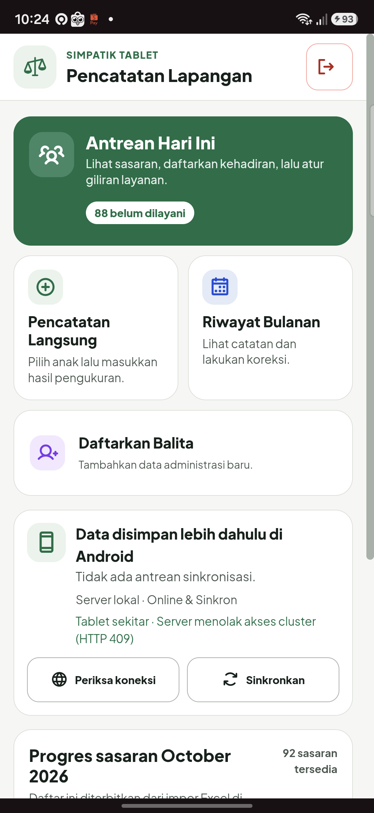
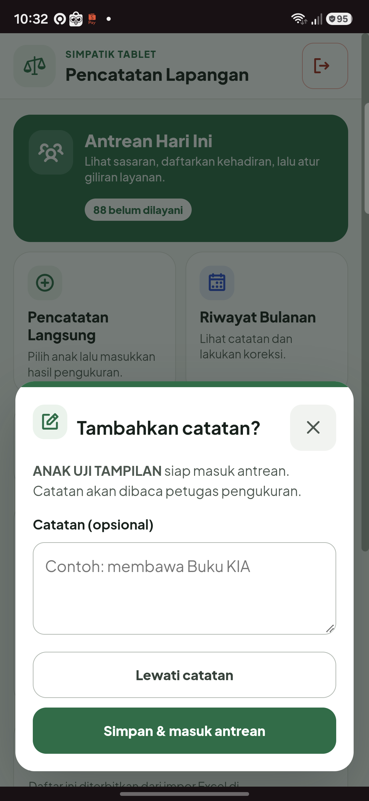

# Walkthrough UI HP dan Catatan Scan — 1.12.3

Tanggal pengujian: 21 Oktober 2026. APK debug versi 1.12.3, versionCode 27.

## Login dan navigasi HP

1. Buka aplikasi. Setelah splash, sesi yang masih sah membuka beranda; tanpa sesi, aplikasi membuka login.
2. Pada login, kata sandi awalnya tersembunyi. Tekan **Lihat** untuk memeriksa pengetikan, lalu **Sembunyikan** untuk menutupnya kembali.
3. Saat keyboard terbuka, form dapat digulir sampai tombol **Masuk** terlihat.
4. Pada beranda portrait, **Antrean Hari Ini** memenuhi satu baris. **Pencatatan Langsung** dan **Riwayat Bulanan** sejajar; **Daftarkan Balita** memenuhi baris berikutnya.
5. Gunakan tombol panah untuk kembali. Tombol navigasi utama memakai area sentuh minimal 48 px.

## Scan kartu dan catatan petugas

1. Buka **Antrean Hari Ini**, lalu pilih pemindaian kartu dengan kamera.
2. Setelah QR dikenali dan sasaran ditemukan, muncul **Tambahkan catatan?**. Anak belum dimasukkan ke antrean pada tahap ini.
3. Isi catatan opsional, misalnya membawa Buku KIA, lalu tekan **Simpan & masuk antrean**. Catatan melekat pada pendaftaran antrean untuk petugas pengukuran.
4. Tekan **Lewati catatan** untuk langsung mendaftarkan anak tanpa menyimpan draf catatan.
5. Tombol **×** atau Kembali Android membatalkan langkah ini tanpa mendaftarkan anak. Saat keyboard terbuka, Kembali pertama dapat menutup keyboard terlebih dahulu.
6. Kartu anak yang sudah terdaftar hari itu ditolak agar tidak membuat antrean ganda. Konfirmasi berulang juga tidak membuat entri tambahan.

## Hasil pengujian

| Pemeriksaan | Hasil |
| --- | --- |
| Build `assembleDebug` | Lulus |
| Regresi JavaScript | 38 lulus, 0 gagal |
| Samsung SM-S711B, Android 16, portrait 384 px CSS | Lulus; tinggi kontainer sekitar 782 px, bukan 0 |
| Login dengan keyboard | Tinggi area terlihat sekitar 454 px; tombol Masuk dapat digulir ke area terlihat |
| Lihat/Sembunyikan password | Lulus; nilai tetap sama dan kata sandi kembali tersembunyi |
| Beranda, pendaftaran, daftar pencatatan dan daftar riwayat | Lulus; tidak ada overflow horizontal pada HP |
| Restart aplikasi dan sesi tersimpan | Lulus; sesi sah kembali ke beranda |
| Rotasi landscape lalu portrait | Lulus; tinggi aplikasi tetap terukur dan pengaturan rotasi semula dipulihkan |
| Popup hasil scan di HP dengan keyboard | Lulus; tombol simpan/lewati tetap terlihat |
| Alur simpan, lewati, batal dan Kembali | Lulus memakai hasil decode kartu simulasi; penulisan antrean uji dicegat |
| Emulator Pixel Tablet, layout 1280 × 716 px CSS | Pemeriksaan DOM/tindakan pada iterasi popup awal lulus. Verifikasi visual APK final belum tuntas: System UI emulator mengalami ANR, lalu proses launch macet setelah cold boot dengan renderer software. Ini belum dihitung lulus penuh. |

HP diperbarui memakai instalasi pembaruan APK. Aplikasi tidak dihapus dan data lokal tidak dibersihkan. Tidak ada pendaftaran anak, pengukuran, atau antrean percobaan yang sengaja ditulis ke database nyata.

Uji hasil scan memanggil callback yang sama dengan hasil decoder kamera menggunakan sasaran sintetis. Pembacaan optik kartu cetak oleh kamera fisik belum diverifikasi. Uji ini tidak menyatakan sinkronisasi antarperangkat sudah lulus.

Hanya HP fisik yang terhubung saat pengujian. Pengujian akhir pada tablet fisik masih diperlukan; screenshot emulator yang tertutup dialog System UI tidak dipakai sebagai bukti tampilan final yang bersih.

## Status HTTP 409 Nearby pada akun Mirae

Permintaan GET `/api/v1/cluster-context` dari sesi Mirae mendapat respons 409 dengan pesan server: **“Akun belum terikat ke satu Posyandu. Minta admin menetapkan wilayah akun.”**

Ini membatasi pembentukan cluster Nearby. Pada pengujian, pemeriksaan koneksi API online tetap menyatakan API dan database siap. Akun Mirae tetap super admin; pengujian ini tidak mengubah wilayah maupun kata sandinya. Operasional Nearby memerlukan satu Posyandu yang jelas. Pemilihan Posyandu aktif untuk akun lintas wilayah masih perlu ditangani.

## APK

File: `app/build/outputs/apk/debug/SIMPATIK-1.12.3-debug.apk`.

Ukuran: 14.047.186 byte.

SHA-256: `c8f9c523f47482f790c0e01f9878dce806ae1ba4ef617a6e3559e14999ea3fd7`.
